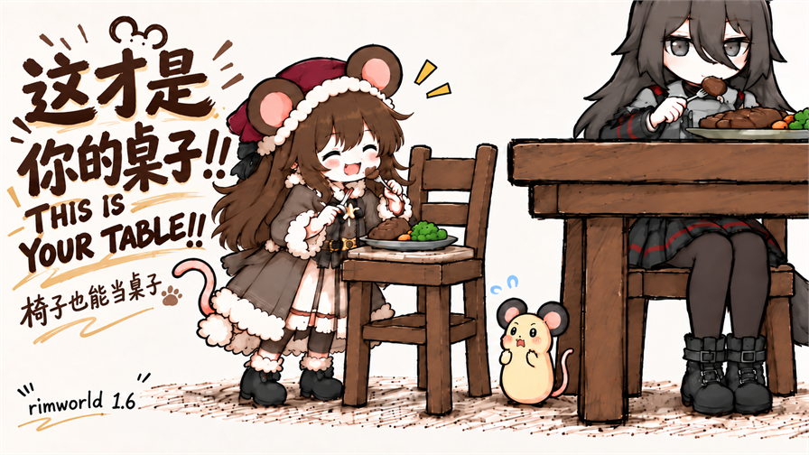

# 这才是你的桌子！！ · This Is Your Table!!



让鼠鼠把没有相邻餐桌的独立椅子当成临时饭台。已会自主吃饭的鼠蛋还可以请求护理者抱上椅子，自己把饭吃完。

作者：冷涣 / lenghuan · 当前 GitHub 候选版本：**1.2.1** · 游戏版本：**RimWorld 1.6 / 1.7**

## 下载与安装

在本仓库 Releases 下载 `RatkinDiningEtiquette-1.2.1.zip`，解压后将 `RatkinDiningEtiquette` 文件夹放入游戏 `Mods` 目录。避免同时启用工坊版和手动安装版。

[Steam 创意工坊](https://steamcommunity.com/sharedfiles/filedetails/?id=3812440999)提供已有工坊条目；GitHub 候选版本不代表该版本已经更新到工坊。

## 玩法与设置

- 普通独立椅子和已识别的鼠族椅子均可使用；旁边有餐桌的椅子由原版或其他模组处理。
- 可选的马桶和其他特殊座位玩法按殖民者、访客、囚犯、奴隶分别设置，默认仅囚犯和奴隶开启。
- **实验性玩法“鼠蛋求抱上椅子”的总开关默认开启，身份分类默认仅殖民者开启；访客、囚犯和奴隶默认关闭。**
- **请手动关闭 Toddlers 的“允许喂食能自主吃饭的婴儿” / `Pawns feed toddlers who could feed themselves`**，以展示鼠蛋自己取饭、求助上椅子的流程。不会自主进食的婴儿仍正常喂养。

## 依赖与兼容

需要 Harmony、Biotech、Humanoid Alien Races、NewRatkinPlus 和 Toddlers。请按 About 元数据及模组管理器处理加载顺序。Dubs Bad Hygiene 为可选支持。

游戏内文本包含简体中文、英语、日语、韩语和俄语。日、韩、俄文本尚未经过母语校对。

1.7 已单独构建并通过部分真实 API、存档和补丁代码生成检查，**仍是实验性支持**：尚未完成整套依赖及游戏内流程验收，Harmony detour 宿主检查仍有运行时阻碍。使用前请确认各依赖的游戏版本支持并备份存档。

## 构建

```powershell
dotnet build Source/RatkinDiningEtiquette.csproj -c Release -p:RimWorldManagedDir="你的1.6游戏Managed目录" -p:WorkshopRoot="你的workshop/content/294100目录"
dotnet build Source/RatkinDiningEtiquette.1.7.csproj -c Release -p:RimWorldDir="你的1.7游戏目录" -p:WorkshopRoot="你的workshop/content/294100目录"
```

1.6 需要 .NET Framework 4.7.2 编译支持，1.7 需要 .NET 10 SDK 和对应游戏、Harmony、Toddlers 程序集。游戏和依赖模组 DLL 不随源码分发。

## 反馈问题

请在 Issues 提供游戏版本、模组版本、触发步骤和相关日志；提交前遮去日志中的个人信息。离线测试通过不等同于完整游戏验收。

## English

Ratkin can use a standalone chair as a little dining surface. Toddlers who can feed themselves may ask a caregiver to lift them onto a chair. Download the runtime ZIP from Releases; required mods are listed in `About/About.xml`. Toddler assistance is experimental and enabled for colonists only by default. Manually disable Toddlers' **Pawns feed toddlers who could feed themselves** to showcase the self-service request flow. RimWorld 1.7 support is experimental and depends on compatible versions of every required mod.
